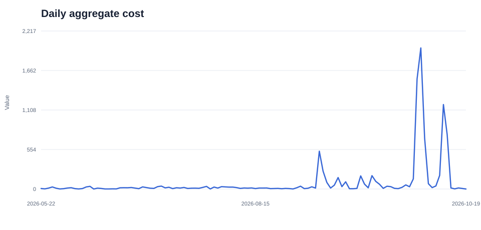
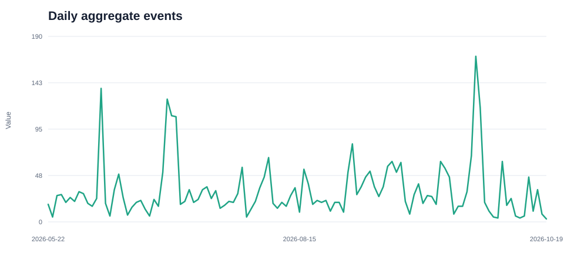
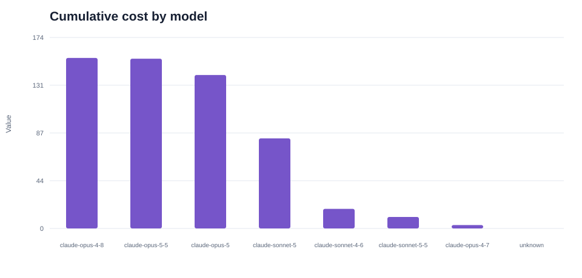

# Agentic Analytics Dashboard

An end-to-end analytics case study of daily community usage aggregates. This project uses SQL to clean the data and Python to explore reported activity, token volume, and cost over time and across models.

> **Data note:** Metric units and definitions are not documented in the supplied `community.csv` export. Results are descriptive of the fields as provided.

## Business context

Teams operating agentic AI systems need to understand how usage and reported costs change over time and how those totals are distributed across models. Before presenting those measures in a dashboard, analysts must validate the source, understand its aggregation level, and avoid combining overlapping rollups.

## Objectives

- Summarize aggregate activity, token volume, and reported cost by observed date.
- Compare reported events, tokens, and cost across models.
- Identify data-quality issues and missing definitions that limit interpretation.

## Tools and methods

- **SQL (SQLite):** normalizes labels, validates dates and numeric fields, converts blank quality and latency values to `NULL`, and removes exact duplicate rows.
- **Python:** loads the CSV into SQLite, applies the SQL cleaning view, calculates summary metrics, exports cleaned data, and generates SVG charts.
- **Analysis design:** uses `dimension = 'total'` for overall trends and `dimension = 'model'` for model comparisons. These are overlapping rollups, so rows across dimensions are never added together.

## Key findings

The export contains **518 cleaned rows** across **114 observed dates**, from **May 22 through October 19, 2026**.

| Measure | Result | Interpretation |
|---|---:|---|
| Reported events | 3,665 | Sum of the `total` dimension only |
| Reported tokens | 194,648,481,236 | Sum of the `total` dimension only |
| Reported cost | 9,843.659769 | Source units; currency unspecified |
| Average reported cost per observed date | 86.347893 | Mean over observed dates; absent dates are not imputed |
| Highest cumulative model cost | `claude-opus-4-8` — 155.662048 | Not normalized for usage or observed days |

### Data-quality findings

- `success` is `0` for every row. Its definition and encoding are unknown, so this project does not interpret it as a success rate.
- `quality_avg` and `latency_avg_ms` are blank throughout, so they cannot support quality or latency comparisons.
- `platform`, `provider`, and `use_case` each have only one observed category.
- Cost units and definitions of events and tokens are not provided. No currency conversion or normalized efficiency ranking is reported.
- Missing dates remain missing; they are not treated as zero-usage days.

## Visualizations

### Daily reported cost



### Daily reported events



### Cumulative reported cost by model



These charts show reported values only. They do not establish why values changed. Model totals cover different numbers of observed dates and activity levels.

## Workflow

1. **Profile the source:** inspect columns, row count, date coverage, dimension categories, missing values, and duplicates.
2. **Clean with SQL:** normalize labels, validate dates and numeric values, convert blank quality and latency fields to `NULL`, and remove exact duplicates.
3. **Respect the data grain:** use total rows for overall trends and model rows for model comparisons. Do not sum across all dimensions.
4. **Explore with Python:** calculate descriptive metrics and generate SVG charts.
5. **Document limitations:** keep undefined units and unavailable quality fields visible alongside dashboard metrics.

## Reproduce

Requires Python 3.10 or later. The project uses Python’s standard library and built-in SQLite; no third-party packages are required.

```bash
python src/run_analysis.py
```

The script reads `data/community.csv` and regenerates `data/community_clean.csv`, `reports/eda_summary.md`, and the figures in `reports/figures/`.

## Repository structure

```text
agentic-analytics-dashboard/
├── data/
│   ├── community.csv
│   └── community_clean.csv
├── reports/
│   ├── eda_summary.md
│   └── figures/
├── sql/
│   └── cleaning.sql
├── src/
│   └── run_analysis.py
└── README.md
```

## Limitations

This is exploratory analysis of aggregate data, not a causal study or user-level analysis. 
The source does not document collection methodology, event/token definitions, cost units, or success semantics.
Cumulative model cost is not normalized by event volume, token volume, or observation days, and should not be presented as model efficiency.
These results describe only the supplied extract.
